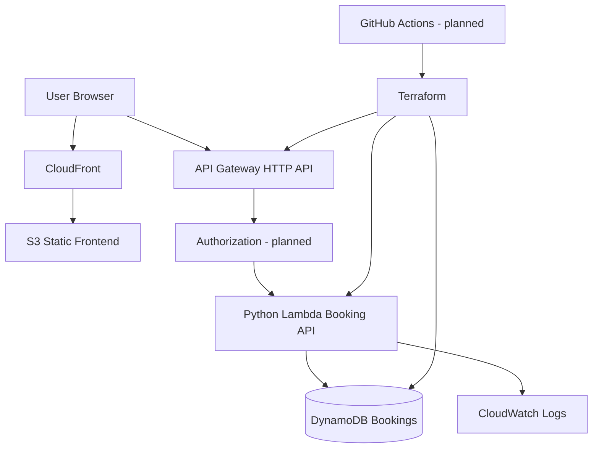

# Architecture (Phase 1)

## Security design
- Private S3 bucket with CloudFront Origin Access Control.
- Least-privilege Lambda role for DynamoDB access.
- Authenticated users and ownership checks for booking reads/writes.
- Validate dates, payload sizes, service and status values.
- API throttling, safe CORS and structured logging without personal information.
- Avoid committing AWS credentials or Terraform state.

## Deployment decisions
AWS region: ap-southeast-1 (configurable). Python Lambda runtime: choose a currently supported runtime at implementation time. DynamoDB on-demand billing for a small demo. Set AWS budgets before deployment.
